# 6. Diseños de PCB en Altium Designer

!!! abstract "Objetivo de esta fase"
    Esta sección documenta el proceso completo de diseño y fabricación industrial de una placa de circuito impreso (PCB) de dos capas utilizando **Altium Designer**. A lo largo del capítulo se toma como proyecto práctico de aplicación el desarrollo de la PCB para un **Volante Gamer con ESP32**, abarcando desde la configuración del entorno y la creación del esquemático, hasta el enrutado, colocación de polígonos de cobre y la exportación de archivos Gerber para su manufactura.

---

## 6.1 Fase 1: Instalación y Configuración del Entorno

El primer paso para comenzar a diseñar nuestra placa de circuito impreso es contar con el entorno de desarrollo adecuado.

1. **Descarga del Software:** Accede al portal oficial de descargas de Altium a través del enlace:

  <a href="https://www.altium.com/products/download/" target="_blank" class="btn-descarga">
    📥 Descargar Altium disagner Oficial
  </a>

---

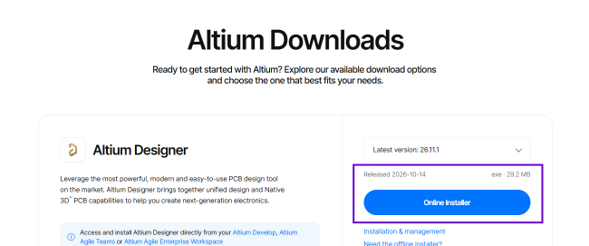
*Figura 6.1: Descarga del instalador en línea de Altium Designer.*

2. **Instalación:** Ejecuta el instalador oficial (`Online Installer`). Durante el asistente de configuración, asegúrate de marcar los paquetes básicos de diseño (*Tools* y *Extensions*) para habilitar las bibliotecas y herramientas de exportación requeridas.

3. **Gestión de Licencias:** Abre Altium Designer e inicia sesión. Dirígete a la esquina superior derecha y selecciona **"Sign in"** o la opción **Licenses...** dentro de *License Management*.

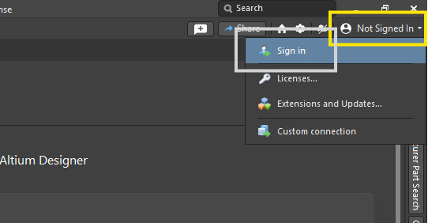
*Figura 6.2: Menú de acceso a la gestión de licencias.*

4. Verifica que la cuenta institucional o licencia educativa asignada se encuentre activa y marcada en estado *In Use*.

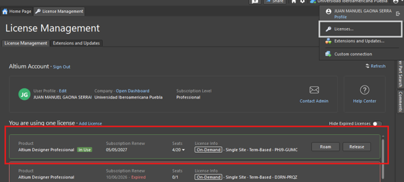
*Figura 6.3: Confirmación de la licencia institucional activa.*

5. **Creación del Proyecto:** En el menú superior, selecciona **File > New > Project**. Asigna un nombre descriptivo a la carpeta del proyecto (por ejemplo, `PCB_Project_produccion`) y confirma su creación en el directorio local o en el Workspace.

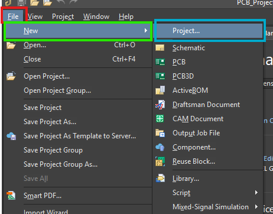
*Figura 6.4: Menú para la creación de un nuevo proyecto en Altium.*

---

## 6.2 Fase 2: Creación del Esquemático

El esquemático constituye la representación lógica del circuito, donde se definen los componentes electrónicos y las interconexiones eléctricas.

### Búsqueda de Componentes

1. Abre el panel lateral **Components** o **Manufacturer Part Search** (accediendo desde el botón *Panels* en la esquina inferior derecha).

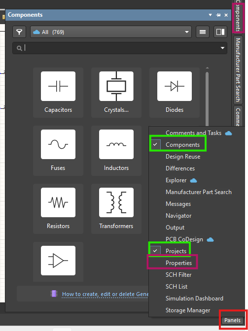
*Figura 6.5: Apertura del panel de componentes desde la barra inferior.*

2. Localiza e importa los componentes requeridos para el proyecto:
   * Microcontrolador **ESP32** (módulo principal).
   * Botones / Pulsadores (switches tipo Omron para los mandos).
   * Diodo rectificador **1N4007** para protección contra polaridad inversa.
   * Conectores (*Headers* macho/hembra) para la pantalla OLED y periféricos.
   * Resistencias de limitación de corriente.

!!! tip "Verificación de modelos 3D"
    Al seleccionar cada componente dentro de la lista de bibliotecas, verifica en la pestaña de detalles que cuente con su respectiva huella física de PCB (*Footprint*) y modelo 3D integrado. Esto garantizará una transición limpia al entorno de diseño tridimensional.

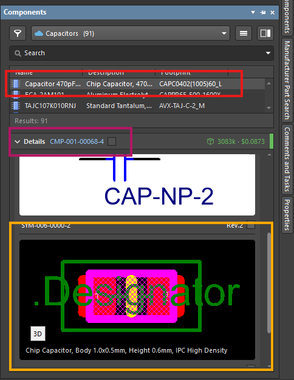
*Figura 6.6: Confirmación del footprint y modelo 3D del componente.*

### Cableado y Etiquetas de Red (Wiring & Net Labels)

1. Arrastra los símbolos al lienzo de trabajo del esquemático (`.SchDoc`).
2. Para interconectar las terminales de alimentación, utiliza la barra de herramientas superior para insertar los puertos **GND** y **VCC (3.3V)**.

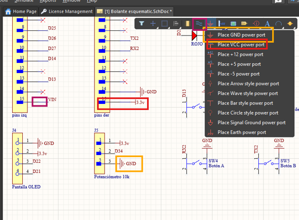
*Figura 6.7: Menú para colocar puertos de alimentación GND y VCC.*

3. Para conectar los pines de señal sin saturar el plano gráfico de líneas, emplea la herramienta **Net Label** disponible en la barra de comandos o mediante el atajo `Ctrl + W`. Asigna el mismo nombre a los nodos que deban estar unidos eléctricamente (por ejemplo, `D21`, `D22`, `D34`).

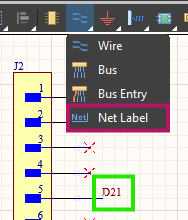
*Figura 6.8: Selección e inserción de una etiqueta de red (Net Label).*

4. En aquellos pines del microcontrolador o conector que no vayan a ser utilizados, coloca un símbolo de no conexión **Generic No ERC** (marcado con una "X" roja), localizado en el menú de utilidades. Esto evitará falsas alarmas durante la verificación eléctrica.

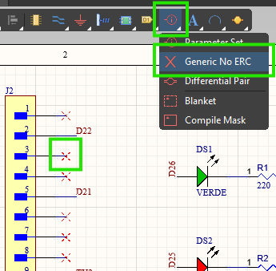
*Figura 6.9: Asignación de marcas No ERC a pines sin uso.*

### Validación del Esquemático

Antes de transferir el diseño a la placa física, verifica la integridad del circuito lógico dirigiéndote al menú superior y seleccionando **Project > Validate PCB Project...**. Si el panel *Messages* no arroja errores ni advertencias críticas, el circuito estará listo para la siguiente fase.

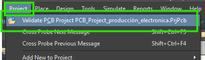
*Figura 6.10: Comando de validación del proyecto en el menú Project.*

---

## 6.3 Fase 3: Transición al Editor de Placas (PCB)

Con el esquemático validado, la información debe sincronizarse con el archivo del lienzo físico de la PCB (`.PcbDoc`).

1. **Sincronización:** Dirígete a **Design > Update PCB Document...**.

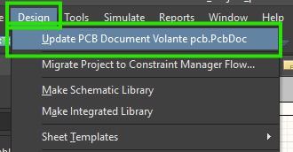
*Figura 6.11: Opción para transferir cambios al entorno de PCB.*

2. **Orden de Cambio de Ingeniería (ECO):** En la ventana emergente *Engineering Change Order*, haz clic primero en **"Validate Changes"** y, tras confirmar la validez, presiona **"Execute Changes"**. Todos los elementos deberán marcarse con iconos de verificación verde.

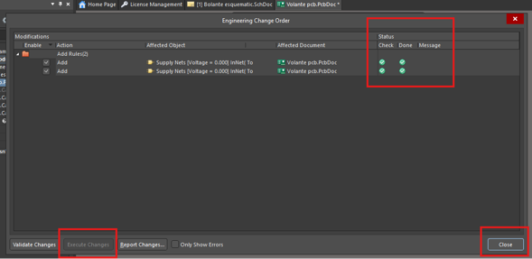
*Figura 6.12: Ventana de validación y ejecución de cambios (ECO).*

3. **Lienzo Inicial y Nido de Ratón (Ratsnest):** Tras la importación, los footprints aparecerán fuera del área de trabajo delimitados por líneas amarillas delgadas (*Ratsnest*), las cuales representan las conexiones lógicas pendientes por rutar.

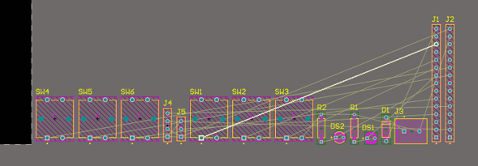
*Figura 6.13: Vista inicial de huellas y conexiones lógicas pendientes.*

---

## 6.4 Fase 4: Enrutado de Pistas y Acomodo de Componentes

En este proceso se transforman las líneas guía virtuales en pistas físicas de cobre por donde circulará la corriente.

### Configuración del Ancho de Pista y Capas

1. Activa la herramienta de enrutado interactivo (`Ctrl + W`). Con la pista seleccionada, ajusta en el panel **Properties** el ancho (*Width*) deseado (por ejemplo, $0.4\text{ mm}$ o $10\text{ mil}$ para líneas de datos, y un grosor mayor para líneas de alimentación).

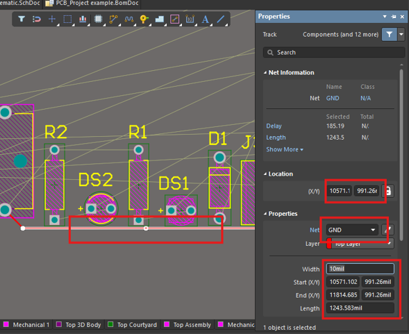
*Figura 6.14: Ajuste del ancho de la pista en el panel de propiedades.*

2. Al tratarse de una PCB de **dos capas**, la herramienta permite alternar entre la capa superior (**Top Layer**, color rojo) y la capa inferior (**Bottom Layer**, color azul). Puedes pasar de una capa a otra colocando vías de interconexión para evitar cruces entre pistas.

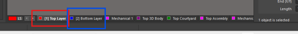
*Figura 6.15: Pestañas de alternancia entre capas Top Layer y Bottom Layer.*

3. **Ubicación de Componentes en la Cara Posterior:** Si requieres montar componentes en la cara inferior de la placa, selecciona el footprint deseado y presiona la tecla <kbd>L</kbd> (*Flip/Layout*). Los componentes ubicados en la cara posterior cambiarán visualmente a color verde.

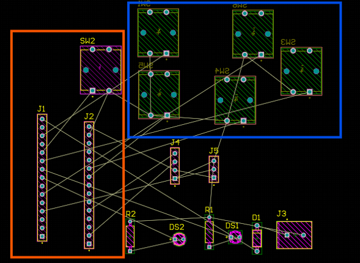
*Figura 6.16: Distribución de componentes en ambas caras del lienzo.*

### Reglas de Enrutado

* **Evitar Ángulos de 90°:** Al trazar las pistas manualmente, realiza los cambios de dirección siempre en ángulos de **45°** para mitigar reflexiones de señal y problemas de manufactura en los esquinas de cobre.
* **Auto-Ruteo:** Para tramos complejos o pruebas preliminares, puedes emplear la función de ruteo automático seleccionando **Route > Auto Route > All...** desde la barra superior.

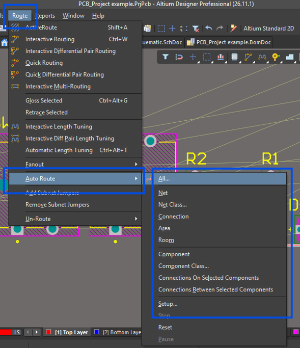
*Figura 6.17: Menú para la ejecución del enrutado automático.*

---

## 6.5 Fase 5: Contorno, Agujeros Mecánicos y Polígonos de Cobre

Para otorgar la forma física final al tablero del volante y proteger la placa contra interferencias electromagnéticas (EMI), se establecen los contornos y planos de tierra.

1. **Perímetro de la Placa:** Selecciona una capa mecánica de trabajo (como **Mechanical 1**) y utiliza la herramienta de trazado de líneas para definir el borde físico y la silueta exterior del dispositivo.

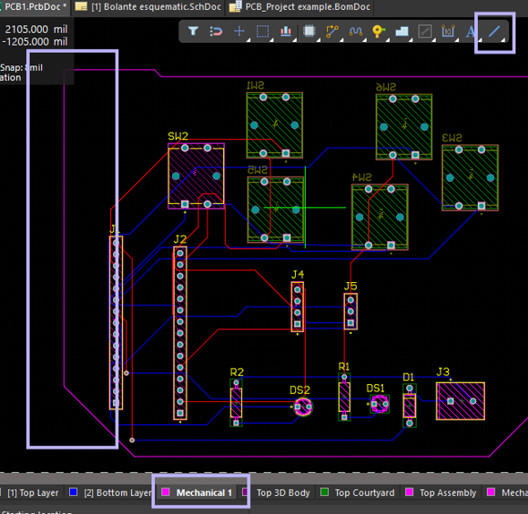
*Figura 6.18: Delimitación del contorno mecánico de la PCB.*

2. **Perforaciones de Montaje:** Coloca un terminal de pad (*Pad*) en cada una de las esquinas del contorno. En el panel **Properties**, configura las siguientes opciones:
   * **Hole Size:** $3.2\text{ mm}$ (diámetro adecuado para tornillería estándar M3).
   * Desactiva la casilla **Plated** para definir el barreno como no metalizado (puramente mecánico).

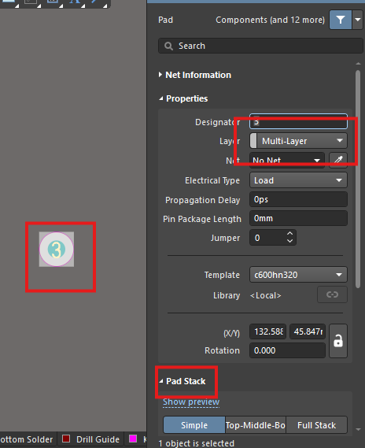
*Figura 6.19: Ajuste del diámetro y estado del barreno en el panel Pad Stack.*

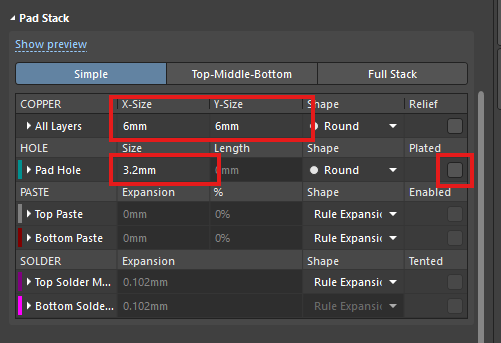
*Figura 6.20: Desactivación de la opción Plated para agujeros de sujeción.*

3. **Plano de Tierra (Polygon Pour):** Selecciona la herramienta **Polygon Pour** para rellenar las áreas desocupadas con un plano de cobre. En sus propiedades:
   * Asigna la red eléctrica a **GND**.
   * Activa la casilla **Remove Dead Copper** (eliminar cobre aislado) para evitar zonas flotantes sin conexión.
   * Ejecuta la orden **Repour** para regenerar el vaciado de cobre.

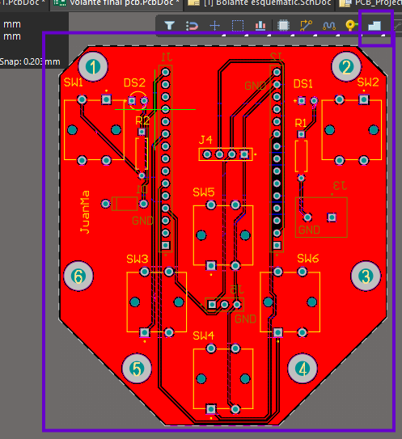
*Figura 6.21: Aplicación del vertido de polígono conectado a masa.*

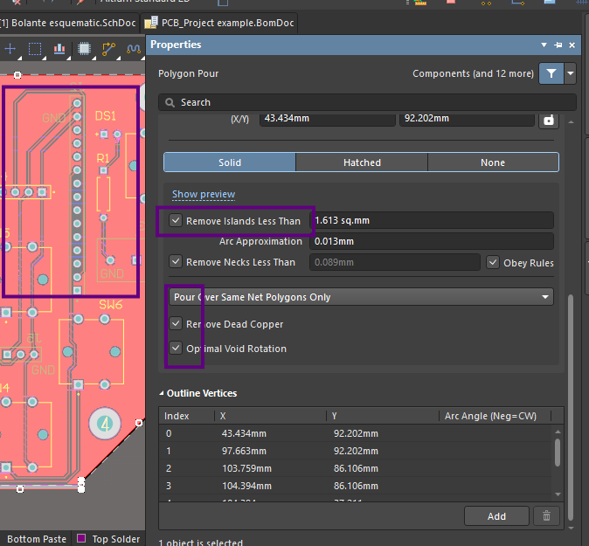
*Figura 6.22: Configuración de vaciado e eliminación de cobre aislado.*

4. **Serigrafía (Silkscreen):** Cambia a la capa **Top Overlay** (color amarillo) para agregar texto personalizado, marcas de identificación (como `"JuanMa"`) o etiquetas aclaratorias en los pines de conexión.

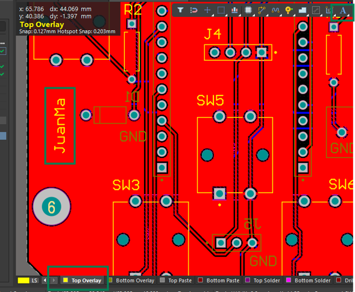
*Figura 6.23: Personalización de leyenda en la capa de serigrafía.*

---

## 6.6 Fase 6: Verificación de Reglas (DRC) y Vista 3D

Antes de enviar el archivo a manufactura, debe verificarse que el diseño cumpla con las tolerancias de fabricación del proveedor industrial (por ejemplo, JLCPCB).

1. **Reglas de Diseño:** Accede al menú **Design > Rules...** para importar o ajustar los parámetros de separación mínima (*Clearance*), anchos de pista y límites de vía solicitados por la planta de fabricación.

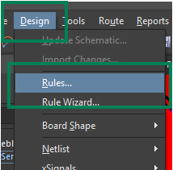
*Figura 6.24: Ventana de acceso a la configuración de reglas.*

2. **Comprobación de Reglas de Diseño (DRC):** Ve al menú **Tools > Design Rule Check...** y haz clic en **Run Design Rule Check...**. El sistema escaneará el tablero en busca de cortocircuitos, pistas muy próximas o inconsistencias en los planos.

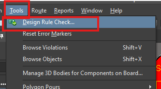
*Figura 6.25: Ventana emergente del comprobador DRC.*

3. **Confirmación:** Revisa el panel **Messages**. Un resultado con **0 Errores** confirma que el diseño cumple con todas las especificaciones eléctricas y físicas.

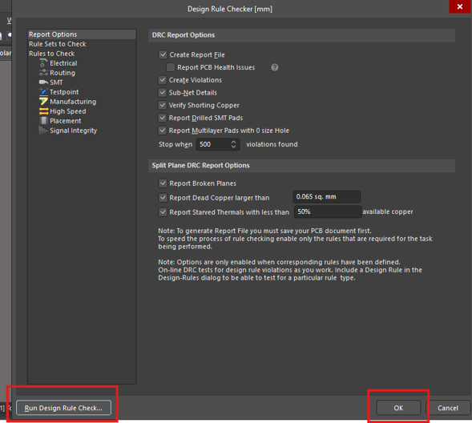
*Figura 6.26: Confirmación de verificación DRC sin errores.*

4. **Inspección Tridimensional:** Presiona la tecla <kbd>3</kbd> para alternar al visor 3D interactivo. Examina la placa para corroborar la alineación de componentes, conectores y serigrafía (presiona la tecla <kbd>2</kbd> para retornar a la vista 2D).

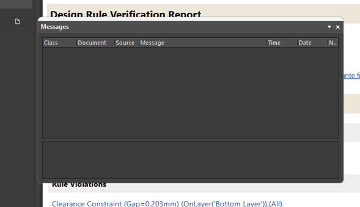
*Figura 6.27: Modelo tridimensional del tablero finalizado.*

---

## 6.7 Fase 7: Generación de Archivos de Fabricación (Gerber & NC Drill)

El último paso consiste en exportar los archivos estándar de la industria necesarios para la producción en masa.

### Exportación de Archivos Gerber

1. Dirígete a **File > Fabrication Outputs > Gerber Files**.

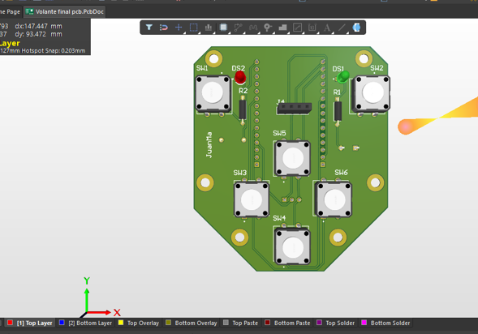
*Figura 6.28: Ruta de menú para la exportación de archivos Gerber.*

2. En la pestaña **Layers**, selecciona e incluye todas las capas utilizadas en el proyecto:
   * **Copper:** `Top Layer` (`.GTL`), `Bottom Layer` (`.GBL`).
   * **Solder Mask:** `Top Solder` (`.GTS`), `Bottom Solder` (`.GBS`).
   * **Silkscreen:** `Top Overlay` (`.GTO`), `Bottom Overlay` (`.GBO`).
   * **Mechanical / Outline:** `Board Profile` (`.GM`).
3. Presiona **Apply** y **OK** para generar las capas.

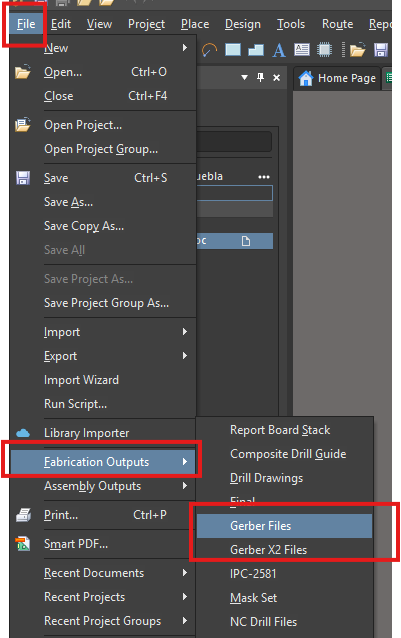
*Figura 6.29: Matriz de selección de capas para salida Gerber.*

### Exportación de Archivos de Perforación (NC Drill Files)

1. Selecciona **File > Fabrication Outputs > NC Drill Files**.

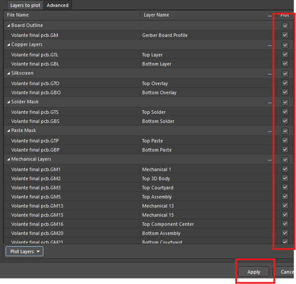
*Figura 6.30: Menú para la generación del código de taladrado.*

2. En la ventana de configuración:
   * **Units:** Selecciona **Millimeters**.
   * **Format:** Selecciona el formato de precisión **4:4**.
3. Haz clic en **OK** para finalizar la exportación.

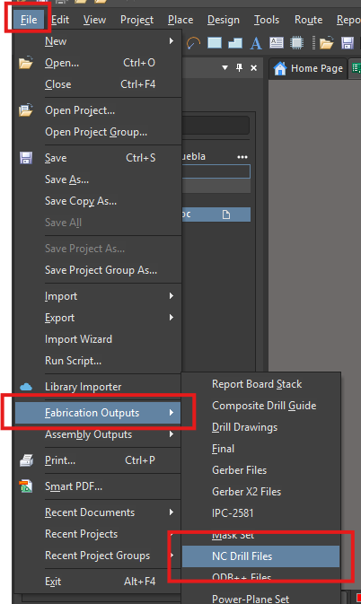
*Figura 6.31: Parámetros de unidad y formato para perforado.*

### Empaquetado Final

Abre el explorador de archivos de tu sistema operativo y navega a la carpeta contenedora del proyecto. Localiza la subcarpeta **`Project Outputs for...`**, selecciona todos los archivos generados (`.GTL`, `.GBL`, `.TXT`, etc.) y comprímelos dentro de un único archivo **`.ZIP`**. Este contenedor comprimido es el paquete final listo para cargarse en la plataforma del fabricante.

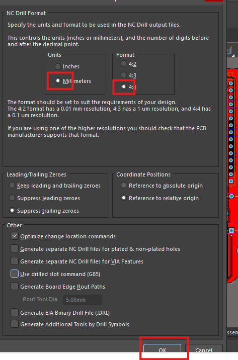
*Figura 6.32: Ubicación de los archivos de salida generados en el proyecto.*
