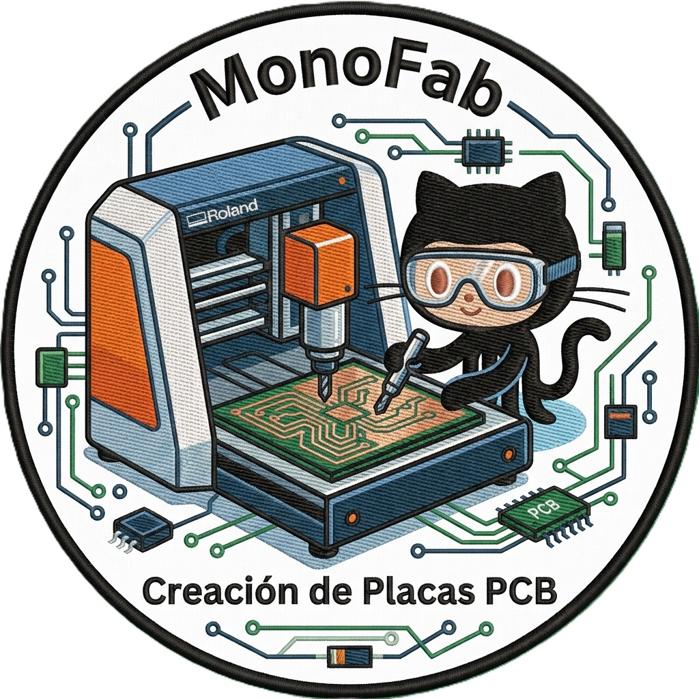
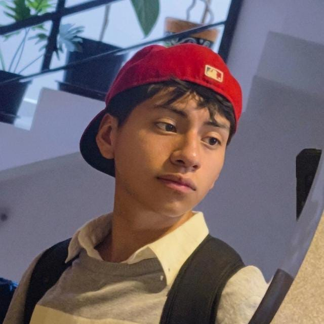
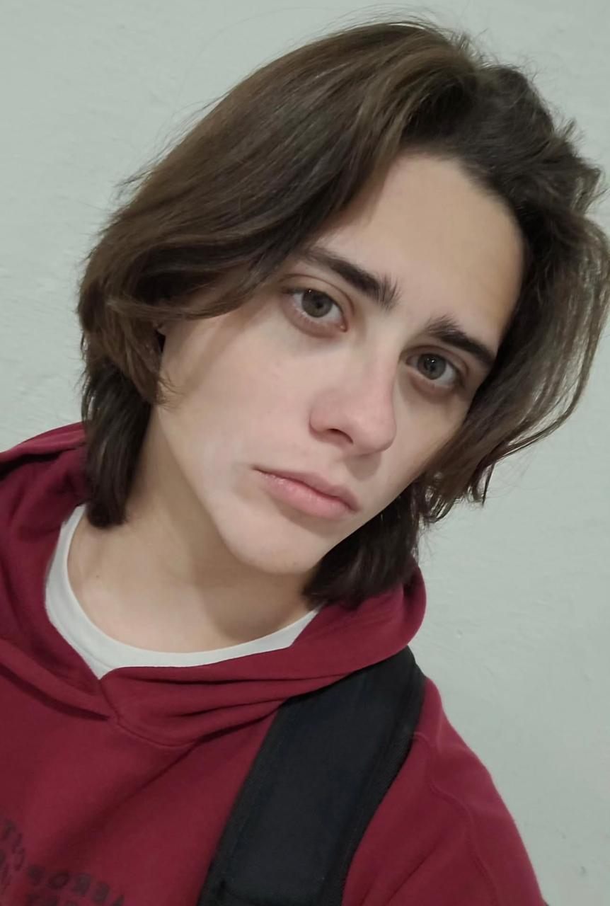

  <!-- Logo de tu equipo -->
  

# Documentación de Producción Electrónica

Bienvenido a la bitácora de nuestro proyecto de Producción Electrónica. En este sitio web documentamos paso a paso todo el flujo de trabajo técnico necesario para el diseño, simulación y manufactura de placas de circuito impreso (PCBs). 

Desde la concepción lógica del diagrama eléctrico, pasando por la simulación del comportamiento de los componentes, hasta llegar a la generación de trayectorias (CAM) y el fresado físico de la placa, aquí encontrarás guías detalladas y los resultados de nuestras prácticas de laboratorio.

---

## Fases del Proyecto

-   📝 **[1. Diseño del Esquemático](esquematico.md)**
    
    ---
    
    Creación del diagrama lógico, selección de componentes y cableado de redes eléctricas.
    
    [Ver documentación ➔](esquematico.md)

-   📐 **[2. Editor de Placas (Layout)](editor-placas.md)**
    
    ---
    
    Diseño físico de la PCB, enrutamiento de pistas, posicionamiento 3D y reglas de diseño.
    
    [Ver documentación ➔](editor-placas.md)

-   💻 **[3. Mods CE (Manufactura CAM)](mods-ce.md)**
    
    ---
    
    Generación de trayectorias de fresado (archivos G-Code/RML) a partir de vectores para la máquina CNC.
    
    [Ver documentación ➔](mods-ce.md)

-   ⚙️ **[4. Operación MonoFab](monoFab.md)**
    
    ---
    
    Configuración, calibración de ejes (X, Y, Z) y uso de la fresadora Roland MonoFab SRM-20.
    
    [Ver documentación ➔](monoFab.md)

-   🔬 **[5. Simulación Multisim](multisim.md)**
    
    ---
    
    Análisis de barrido en DC (DC Sweep), osciloscopios virtuales y validación de circuitos rectificadores.
    
    [Ver documentación ➔](multisim.md)

-   📚 **[6. Referencias y Recursos](recursos.md)**
    
    ---
    
    Material de referencia complementario, hojas de datos (datasheets) y manuales de apoyo.
    
    [Ver documentación ➔](recursos.md)

---

## Nuestro Equipo de Trabajo

Proyecto de Electrónica - IBERO Puebla

<!-- Contenedor del equipo ajustado para 2 personas con descripciones -->

  
  <!-- Carlos -->
  

    
    <h3 style="margin-bottom: 5px; margin-top: 15px; font-size: 1.2em;">Juan Manuel Gaona Serrano</h3>
    
Ingeniero Mecatrónico

    
19 años | Puebla, Puebla

    <blockquote style="font-size: 0.9em; color: #bbb; border-left: 3px solid #e53935; text-align: left; padding-left: 15px; margin: 0; font-style: italic;">
      "La carrera es una de mis mayores formas de sentirme bien conmigo mismo y de lograr ser alguien en la vida."
    </blockquote>
  

  <!-- Luis -->
  

    
    <h3 style="margin-bottom: 5px; margin-top: 15px; font-size: 1.2em;">Brandon Saul Ruvalcaba Perez Oliva</h3>
    
Ingeniero Mecatrónico

    
19 años | Tamaulipas, Tabasco

    <blockquote style="font-size: 0.9em; color: #bbb; border-left: 3px solid #e53935; text-align: left; padding-left: 15px; margin: 0; font-style: italic;">
      "Me gustan crear y aprender cosas nuevas."
    </blockquote>
  

