# 5. Simulación de Circuitos en Multisim

!!! info "Nota importante"
    Todo lo que se muestra a continuación es solo un ejemplo de todo lo que se puede hacer en la aplicación de Multisim. Existen muchas más herramientas y tipos de análisis disponibles.

!!! abstract "Objetivo de esta fase"
    Esta sección documenta el uso de la plataforma de simulación Multisim. Aprenderemos a configurar un análisis de barrido en corriente directa (DC Sweep) para caracterizar un transistor, y posteriormente utilizaremos la simulación interactiva con instrumentos virtuales (como generadores de funciones y osciloscopios) para analizar un circuito rectificador con diodo.

---

## 5.1 Análisis de Barrido en DC (DC Sweep) para Transistores

### Paso 1: Configuración de Parámetros (Analysis Parameters)

En esta primera parte, dentro de la ventana de configuración del *DC Sweep*, nos ubicamos en la pestaña **Analysis parameters**. Lo que estás haciendo aquí es configurar tu análisis en DC para indicarle al simulador qué valores van a ir cambiando. 

Aquí vas a variar tanto tu fuente de voltaje como tu fuente de corriente. En la sección "Source 1" ajustas tu fuente de voltaje principal (VCE), definiendo en qué valor inicia, en dónde termina y de cuánto en cuánto va a ir incrementando. Luego, activas la casilla "Use source 2" para hacer exactamente lo mismo con tu fuente de corriente secundaria.

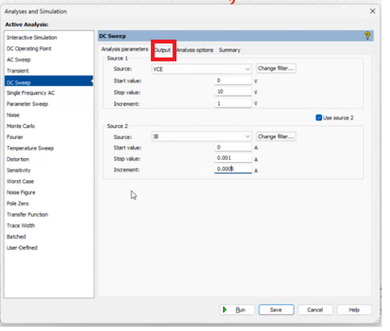
*Figura 5.1: Pestaña Analysis parameters configurando Source 1 y Source 2.*

### Paso 2: Selección de Variables de Salida (Output)

Ahora te pasas a la pestaña de **Output** (Salidas). En este apartado es donde le indicas al simulador qué es lo que quieres detectar o medir en tu circuito. 

En la columna de la izquierda ("Variables in circuit") vas a buscar las variables de tu componente; por ejemplo, si estás analizando un transistor (que en los simuladores normalmente se identifica con la letra Q, como Q1), buscas la corriente que te interesa analizar. Como explicaba el profesor, seleccionas la variable deseada en esta lista (como se observa en el recuadro naranja) y luego le das clic al botón **Add** (Añadir), el cual está resaltado en el recuadro rojo. Esto pasará tu variable a la columna de la derecha ("Selected variables for analysis"), indicando que está lista para ser monitoreada.

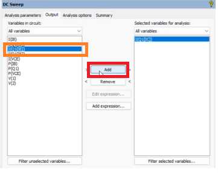
*Figura 5.2: Selección de la variable I(Q1[IC]) para el análisis.*

### Paso 3: Ejecutar el Análisis (Run)

Una vez que ya configuraste los parámetros de tus fuentes y añadiste las variables que quieres medir en el paso anterior, estás listo para ejecutar el análisis. 

Te diriges a la parte inferior de la ventana, donde encontrarás varias opciones de guardado y cancelación. Aquí, simplemente le vas a dar clic al botón **Run** (Correr), el cual está resaltado con un recuadro verde y tiene el icono de un pequeño triángulo de reproducción (play). Como explicaba el profesor, al presionar este botón, el simulador tomará toda la configuración que acabas de hacer y comenzará a generar las gráficas con los resultados de las barridas.

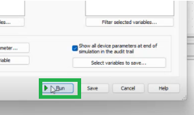
*Figura 5.3: Ejecución de la simulación de barrido.*

### Paso 4: Analizar los Resultados en la Gráfica

Después de haberle dado al botón de correr, se abrirá automáticamente una nueva ventana llamada **Grapher View** (vista de graficador) donde por fin puedes visualizar los resultados obtenidos.

Como mencionaba el profesor anteriormente, aquí se pueden ver las "3 barridas" que el simulador realizó basándose en los valores de inicio, fin e incremento que configuraste en el primer paso. Esta gráfica (llamada *"DC Transfer Characteristic"*) te muestra en el eje vertical (Y) la corriente que decidiste medir y en el eje horizontal (X) el voltaje que fuiste variando.

Si te fijas en los trazos y las flechas de la imagen, te explican a qué corresponde cada línea de color:
*   **La flecha amarilla** señala la línea roja que va por debajo, mostrando el resultado cuando la corriente de tu segunda fuente (IB) equivale a 0.
*   **La flecha naranja** señala la línea verde de en medio, que es el comportamiento de tu circuito cuando la corriente IB incrementó a 0.0005.
*   **La flecha azul** señala la línea azul de hasta arriba, que representa el resultado cuando la corriente IB llegó a su valor máximo configurado de 0.001.

Básicamente, en este apartado pasas a observar y analizar cómo se comporta tu transistor con los diferentes cambios de voltaje y corriente que le programaste en un inicio.

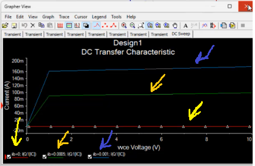
*Figura 5.4: Grapher View mostrando las tres curvas características del transistor.*

### Modificación de Pasos en el Barrido

Si deseas ajustar la resolución de tus gráficas, puedes volver al menú de configuración. En la imagen superior, ese recuadro en la barra de herramientas que dice "DC Sweep" (resaltado en rojo) es justamente el menú al que le das clic para poder entrar a la ventana de configuración de tu simulación.

Una vez que entras desde ese recuadro, se abre la ventana inferior. Como explicaba el profesor, si los resultados iniciales te mostraron 3 barridas pero tú quieres "hacer que sean más o hacer que sean menos", en este apartado pasas a cambiar la cantidad de pasos o valores. El recuadro rojo te señala específicamente los parámetros de tu fuente 2 (IB). Al modificar el valor de *Increment* ahí, ajustas de cuánto en cuánto avanza la corriente y, con eso, controlas cuántas curvas se van a graficar en tu simulación final.

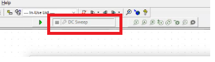
*Figura 5.5: Acceso al menú y modificación del incremento de IB.*

### Análisis del Circuito Base Utilizado

Esta imagen nos muestra el circuito base que armaste para poder hacer todo este ejemplo. Como explicaba el profesor, aquí es donde colocas tus componentes y defines las fuentes que luego el simulador va a reconocer. Si observas bien, el diagrama conecta perfectamente con todo lo que configuramos en los pasos anteriores:

*   **El componente principal:** En el centro tienes a tu transistor, etiquetado como Q1 (es un modelo 2N2222A). Recuerda que en el Paso 2 entraste a las salidas para pedirle al programa que midiera la corriente de este elemento en específico (`I(Q1[IC])`).
*   **Tu fuente de corriente (IB):** Del lado izquierdo tienes conectada una fuente de corriente a la base del transistor, nombrada como IB. Esta es exactamente tu "Source 2" en la configuración de la simulación, a la cual le programaste los incrementos de 0.0005 A.
*   **Tu fuente de voltaje (VCE):** Del lado derecho tienes la fuente de voltaje conectada al colector, nombrada como VCE. Esta es tu "Source 1", a la que le indicaste que hiciera el barrido desde 0 hasta 10 V.

Básicamente, en este apartado armas tu esquema asegurándote de nombrar bien tus fuentes (IB y VCE). De esta manera, cuando entras al recuadro de "DC Sweep" para configurar tu análisis, el programa ya sabe exactamente qué componentes de tu circuito son los que vas a variar.

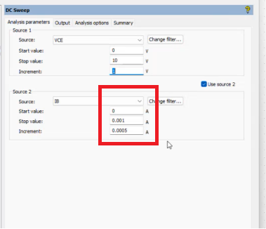
*Figura 5.6: Esquema del circuito para el análisis del transistor.*

---

## 5.2 Simulación Interactiva: Circuito Rectificador

### Paso 6: Añadir un Generador de Funciones

En esta parte, dejas atrás el análisis en DC para comenzar a usar otras herramientas y armar un circuito diferente. Para lograr esto, te diriges a la barra vertical que se encuentra en el lado derecho de la pantalla, la cual contiene todos los instrumentos virtuales del simulador.

Como está resaltado en el recuadro rojo, vas a buscar y darle clic al icono del **Generador de funciones** (*Function Generator*). Una vez seleccionado, mueves tu cursor hacia la cuadrícula de trabajo para colocar el instrumento, el cual se representa visualmente como un bloque con tres tipos de ondas (senoidal, triangular y cuadrada).

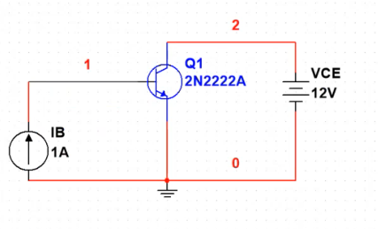
*Figura 5.7: Selección e inserción del generador de funciones.*

### Paso 7: Buscar y Seleccionar Componentes

En esta parte, vamos a agregar los elementos necesarios para armar el nuevo circuito rectificador que mencionó el profesor, utilizando la ventana de componentes.

*   **Abrir el menú de componentes:** Primero, te diriges a la barra de herramientas superior y le das clic al botón que tiene el icono de un diodo (resaltado en el recuadro rojo). Este botón es el acceso directo para entrar a la ventana principal donde podremos seleccionar todos nuestros componentes.
*   **Seleccionar el diodo:** Al darle clic, se abrirá la ventana llamada "Select a Component". Para agregar tu diodo, buscas en la lista de la izquierda llamada "Family" la opción **DIODE** y le das clic. Después, en la lista central, eliges el modelo específico que vayas a usar (en este caso está seleccionado el `1BH62`) y finalmente presionas el botón **OK** en la esquina superior derecha para llevarlo a tu área de trabajo.
*   **Seleccionar la resistencia:** Para la resistencia, repites el mismo proceso dentro de esa ventana. Buscas en la lista de familias la opción **RESISTOR** y la seleccionas. Luego, en la columna central, eliges el valor de tu resistencia (en el ejemplo está marcada una de 1k) y vuelves a presionar el botón **OK** para colocarla en tu circuito.

*Figura 5.8: Selección del diodo y la resistencia desde la base de datos.*

Una vez importados los elementos, procedemos a unirlos cableando el esquemático.

*Figura 5.9: Diagrama del circuito rectificador de media onda armado.*

### Paso 8: Configurar el Modo de Simulación

En las imágenes anteriores puedes ver cómo queda armado el circuito con los componentes que agregaste. Tienes tu Generador de funciones (XFG1) conectado a tu diodo (D1, modelo 1BH62), el cual va en serie con tu resistencia (R1 de 1kΩ), y finalmente todo cierra con la conexión a tierra. Como explicaba el profesor, este arreglo con el diodo te servirá para rectificar la señal alterna que vas a introducir.

Antes de darle al botón de *Run*, debes verificar tu modo de simulación. Como advirtió el profesor, si el programa te marca un error automáticamente al intentar simular, debes ir al menú superior (el recuadro que antes decía "DC Sweep") y asegurarte de seleccionar la opción **"Interactive Simulation"** (Simulación Interactiva). 

Al seleccionar "Interactive", el simulador actualiza su estado (lo que se refleja en el cuadro azul) y ya sabe qué tipo de análisis estás intentando hacer, permitiendo que el circuito funcione de manera normal para que puedas pasar al siguiente paso y conectar tu osciloscopio.

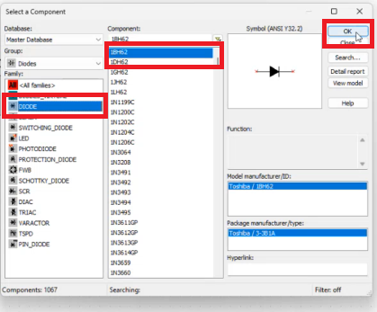
*Figura 5.10: Cambio del modo de análisis a simulación interactiva.*

### Paso 9: Añadir el Osciloscopio Estándar

En esta parte, como indicó el profesor para que se puedan ver bien los resultados, vas a "agarrar un osciloscopio" para poder observar gráficamente qué es lo que está haciendo tu circuito.

Para agregarlo, te diriges nuevamente a la barra vertical de instrumentos que se encuentra en el lado derecho de tu pantalla. En este apartado pasas a buscar y seleccionar el cuarto icono de la lista, el cual está resaltado con el recuadro rojo y pertenece al osciloscopio. Al darle clic, podrás colocar el instrumento en tu área de trabajo, el cual se representa gráficamente como un bloque grande con el dibujo de una onda en el centro y las conexiones para los canales.

Este instrumento será clave para el siguiente paso, ya que te permitirá conectar sus terminales a diferentes puntos de tu arreglo para medir la señal original y ver cómo la rectifica el diodo.

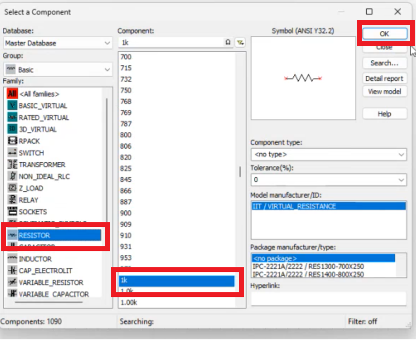
*Figura 5.11: Inserción del osciloscopio virtual en el esquemático.*

### Paso 10: Configurar el Generador de Funciones

Haciendo una pequeña aclaración: la ventana de configuración que aparece en esta imagen en realidad pertenece al generador de funciones (XFG1), no al osciloscopio. Para abrir este menú, debes interactuar (darle doble clic o clic derecho) al bloque del generador de funciones que colocaste al inicio, el cual está resaltado con el recuadro verde grande a la izquierda.

En este apartado pasas a configurar cómo será la señal eléctrica que va a entrar a tu circuito. Como explicaba el profesor, aquí vas a simular la señal alterna que tenemos normalmente en la red eléctrica ajustando dos parámetros clave en la ventana "Function generator-XFG1":
*   **Frecuencia (Frequency):** En el primer recuadro verde, ingresas `60 Hz`, que es el valor normal que utilizamos.
*   **Amplitud (Amplitude):** En el segundo recuadro verde inferior, configuras `120 Vp` (Volts pico), que es la amplitud estándar para la red.

Una vez que ajustas esta ventana, tu circuito ya estará alimentado con la señal correcta para que, en los siguientes pasos, ahora sí utilices el osciloscopio para visualizar cómo el diodo transforma esta onda.

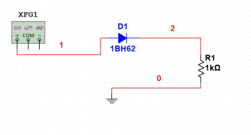
*Figura 5.12: Parámetros del generador configurados a 60 Hz y 120 Vp.*

### Paso 11: Visualizar y Comparar Señales en el Osciloscopio

En esta parte, después de dar doble clic al ícono del osciloscopio (el cual está resaltado con el círculo amarillo en el diagrama), se abre la pantalla principal (la ventana negra) donde por fin se puede visualizar cómo se comporta la señal en el tiempo.

En este apartado, se utilizan y observan las entradas del instrumento mediante la configuración de los canales en la parte inferior de la ventana (Channel A y Channel B). Como mencionaba el profesor, la estrategia aquí es habilitar 2 canales para poder compararlos visualmente. Usualmente, se conecta un canal al inicio del circuito para ver la señal original (la onda completa que se configuró en el generador) y otro canal a la salida del diodo para ver el resultado final.

Al observar la pantalla negra, se aprecia claramente el resultado de la simulación interactiva: la gráfica muestra únicamente unas curvas o "montañas" en la parte superior. Esto comprueba visualmente la teoría explicada por el profesor, donde el diodo rectificó la señal alterna original, bloqueando la parte negativa de la onda y dejando pasar solo la mitad positiva.

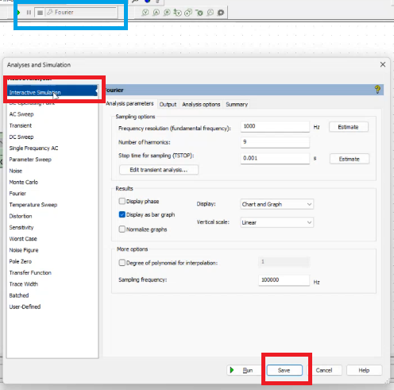
*Figura 5.13: Señal rectificada visualizada en el osciloscopio estándar.*

!!! tip "Diferenciar Señales (Net Color)"
    Para hacer más fácil la lectura de las gráficas en el osciloscopio, puedes cambiar el color de los cables de conexión. Haces clic derecho sobre un segmento de cable, seleccionas **Properties** (o *Segment color*) y en la ventana emergente modificas el "Net color" eligiendo un color distinto (por ejemplo, verde o azul). Esto hará que la señal en el osciloscopio se dibuje de ese mismo color, facilitando la comparación.

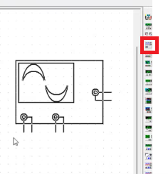
*Figura 5.14: Modificación del color de red (Net color) para organización visual.*

### Alternativa: Uso del Osciloscopio Tektronix

Además del osciloscopio estándar, puedes ocupar otro tipo de osciloscopio disponible en la barra de herramientas derecha. Se hacen las conexiones correspondientes al circuito de igual forma.

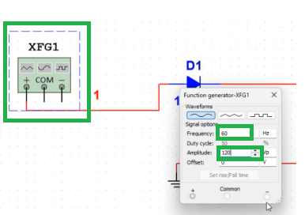
*Figura 5.15: Selección e integración del osciloscopio Tektronix en el esquemático.*

Este osciloscopio es muy parecido a los de la vida real, más en específico al modelo **Tektronix TDS 2024**. Al abrir su interfaz interactiva, puedes manipular las perillas virtuales de tiempo y voltaje de la misma manera que lo harías en un laboratorio físico.

En conclusión, se pueden hacer muchas simulaciones y tomar muchos tipos de tomas con osciloscopios y otras herramientas dentro de Multisim para comprobar el comportamiento de nuestros circuitos electrónicos.

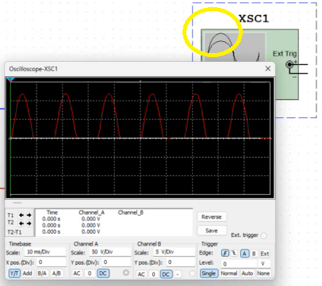
*Figura 5.16: Visualización de las ondas de entrada y salida en la interfaz del Tektronix virtual.*
